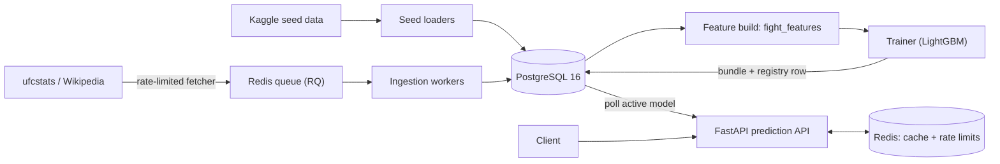
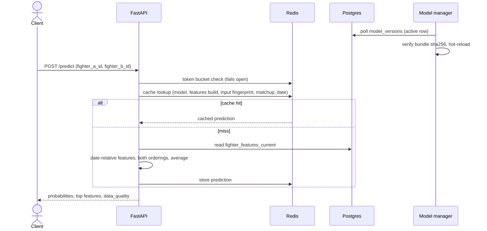

<div align="center">

# CageOps

**A production-style ML platform for UFC fight prediction: a polite ingestion queue, point-in-time features, a model registry, and a cached, rate-limited serving API.**


</div>

<!-- TODO: record a short terminal demo (curl POST /predict with jq) and save it as docs/demo.gif. Delete the image line if you skip it. -->


**Tech:** Python 3.12 · FastAPI · PostgreSQL 16 (pgvector) · Redis · RQ · LightGBM · SQLAlchemy · Docker · k6 · GitHub Actions

---

## Overview

Most ML portfolio projects are a notebook and a model file. The hard part of a real ML product is everything around the model: getting data from sites that don't want to be scraped, making sure the features never see the future, knowing which model version is live, and serving predictions without falling over. CageOps is built to practice exactly that. The domain is UFC; the point is the infrastructure.

I'm building it solo in phases, each ending in a merged PR with its decisions logged in `docs/DECISIONS.md` and every performance claim backed by a reproducible entry in `docs/BENCHMARKS.md`. Phases 0 to 2b are done: ingestion, features, model training, and the prediction API. The first deploy, the frontend, and Kubernetes are next. Not affiliated with the UFC and not betting advice.

## Features

**Ingestion that stays polite.** Fetching goes through one shared rate limiter (about 1 request per second across all workers), checks `robots.txt`, caches raw HTML, and retries with backoff into a dead-letter queue. When a site puts up a bot challenge, a circuit breaker stops every worker and CageOps does not try to get past it.

**Features that cannot see the future.** Every feature for a fight is built only from that fighter's fights strictly before it, and tests prove it. One command rebuilds the whole table.

**Honest model evaluation.** Training uses time-based splits, never random ones, and the model is always scored against the betting favorite and a simple experience/ranking heuristic. The model loses to the favorite, and the repo says so.

**One live model at a time, enforced by the database.** Versions live in a Postgres registry, the API hot-reloads the active one, and training refuses to run on stale features.

**A prediction API that explains itself.** `POST /predict` returns win and method probabilities, the top contributing features, and a `data_quality` block that separates "features are current" from "rates are complete". It is backed by a Redis cache, per-client rate limiting, and Prometheus metrics.

## Results

- Seed dataset of 8,555 fights, 774 events, 2,686 fighters, and 40,244 per-round stat rows, plus 224 recent fights from Wikipedia filled in for the gap
- Win/loss model scores 59.1% accuracy and 0.669 log loss on 553 held-out fights, beating a coin flip (0.693) and the experience heuristic (0.708)
- The model loses to the betting favorite on the 241 test fights that have odds (log loss 0.639 against 0.554, paired-bootstrap interval excludes zero)
- API load test on one process: 219 req/s on cold predictions, 1,364 req/s cached, 382 req/s on a mixed workload, with zero failures
- 1,000+ tests, including leakage tests and integration tests against real Postgres in CI; the API image is 612 MiB and built and checked on every PR

## Tech Stack

| Layer | Technology | Notes |
| ----- | ---------- | ----- |
| Language / tooling | [Python 3.12](https://www.python.org/) + [uv](https://docs.astral.sh/uv/) workspace | One workspace with a shared `cageops_common` package and four services. |
| API | [FastAPI](https://fastapi.tiangolo.com/) + [Pydantic](https://docs.pydantic.dev/) | Prediction, fighter search, and upcoming-events endpoints. |
| Database | [PostgreSQL 16](https://www.postgresql.org/) + [pgvector](https://github.com/pgvector/pgvector) | Raw tables, point-in-time features, model registry, ingestion state. |
| Migrations / ORM | [SQLAlchemy 2](https://www.sqlalchemy.org/) + [Alembic](https://alembic.sqlalchemy.org/) | 11 migrations; schema changes only go through Alembic. |
| Queue / cache | [Redis 7](https://redis.io/) + [RQ](https://python-rq.org/) | Ingestion jobs, shared rate limiter, prediction cache, API rate limits. |
| Modeling | [LightGBM](https://lightgbm.readthedocs.io/) | Win/loss and method models, deterministic training. |
| Load testing | [k6](https://k6.io/) | Runs against the API on the compose network. |
| CI / containers | [GitHub Actions](https://github.com/features/actions) + [Docker Compose](https://docs.docker.com/compose/) | Ruff, pytest, compose validation, and an image build and check on every PR. |

## Screenshots

<!-- TODO: capture each of these in a terminal on the machine that has CageOps running, then save to docs/screenshots/. -->

**Prediction API:** `POST /predict` with top contributing features and a data quality block


**Model report:** the trained model against the betting favorite and the heuristic baseline


**Ingestion worker:** a backfill draining the queue under the shared rate limiter


**Load test:** k6 results for cold, warm, and mixed prediction traffic


## Architecture



Training and serving share one inference module in `cageops_common`, so both build a model input the same way, and the API image carries no training code at all.

## Engineering Decisions

**Treating a bot challenge as a stop signal.** The main results source, ufcstats.com, started serving a proof-of-work browser check on every page. Solving it in code would have worked, and it would also have been circumventing an access control, which undercuts the "public pages" argument the scraping policy rests on. So the rule became permanent: no challenge solvers, no headless browsers, no proxy or User-Agent rotation. The fetcher treats a challenge page as a circuit breaker that stops every worker and stays open until a human resets it. The pipeline was built behind a `Source` interface against saved fixtures and a local replay server, and English Wikipedia's event articles became a second, robots-compliant source to fill the gap (ufcstats rows always win on conflict). The cost is that ingestion has never run against the real ufcstats site, and every ingestion benchmark is labeled as a replay-server number.

**Making "before" a single function.** Point-in-time correctness is easy to say and easy to break, so the feature builder is a pure Python function that is handed only a fighter's prior fights, and one other function, `prior_fights`, is the only place a date decides what counts as history. That makes the leakage tests callable without a database. Rates are ratios of sums, so a 20-second knockout doesn't dominate, and any zero denominator is NULL instead of 0, so "no data" is never confused with "none landed". The tradeoff is documented: a rebuild uses current results, so a result overturned later quietly rewrites history for that fighter's later fights.

**Hashing inputs instead of comparing timestamps.** A model is only useful if you can say what it was trained on, so versions go in a `model_versions` table and a partial unique index lets Postgres itself guarantee that at most one is active. The harder question was staleness. Timestamps missed real cases: ingestion writes no `load_runs` rows, and replaying the dead-letter queue re-parses cached HTML, so fights can change with no new fetch at all. Instead, the feature build stores a fingerprint of exactly the columns that can change a feature or label, and the trainer refuses to run if the database no longer matches it. A test fails if any column of those tables is added without being classified in or out of the hash.

**Making predictions symmetric by construction.** The red corner wins 64% of fights, so a model that sees corner order learns a bias. Fighters get a neutral order, training uses one seeded random swap per fight, and prediction asks the model both ways and averages: `p_a = (f(a, b) + 1 - f(b, a)) / 2`. That guarantees `P(A) + P(B) = 1` and that swapping the fighters returns the mirror image, whatever the model learned. Tests cover both properties, plus one that checks the raw model alone is not symmetric, so the averaging can't quietly become dead code.

**Putting every input into the cache key, then measuring the rate limiter.** The obvious cache key (fighter A, fighter B, model version) would serve confident wrong numbers after a features rebuild, a newly ingested result, or midnight. The key also carries the features build id, a 12-digit input fingerprint, the matchup context, and the as-of date, and the cache fails open so a Redis outage can't take the API down. The load test then caught a real problem: the first rate limiter ran a blocking Redis call in a worker thread, costing 0.39 ms per request, or 35% of cached throughput. Awaiting the call directly brought the cost down to 0.10 ms per request and 14% of cached throughput.

## What's Next

- Finish the first deploy (phase 2c). The API image is built and checked in CI but not pushed anywhere yet, and the Redis in compose has no `maxmemory` set.
- Build the frontend in `web/` (Next.js). It's a placeholder today, and the API already supports a server-to-server key plus a forwarded end-user IP for it.
- Schedule retraining and a grading loop (phase 5), including a refit on train plus validation and the daily odds loader that would raise favorite coverage from 241 of 553 test fights to 478.
- Add Kubernetes (k3s), Prometheus and Grafana, and more API replicas. One process is the throughput limit today, and fewer queries per prediction is the other lever.

<details>
<summary><b>Technical deep dive</b></summary>

**Core mechanic:** Results flow from sources into Postgres through a rate-limited queue; a pure-function feature build produces point-in-time rows; the trainer fits and registers a model bundle; and the API loads the active bundle and answers predictions from current features.

### Prediction sequence



### Architecture notes

- **Training and serving build one model input.** The inference module lives in `cageops_common`, and a test (`test_no_trainer_import.py`) fails if the API image ever imports trainer code.
- **Hot reload by polling.** The model manager polls `model_versions` and verifies each artifact's sha256 before swapping, which is simpler than pub/sub and survives restarts.
- **Idempotent ingestion.** Upserts only write where the row `IS DISTINCT FROM` the new one, and jobs are deduplicated with claim keys because RQ doesn't dedupe job ids. Workers run `SimpleWorker`, so ingestion supports Linux and macOS only.
- **Freshness is not completeness.** `data_quality` reports whether features are current separately from whether rates are complete, so a fighter whose newest bout has no per-round stats is flagged, not silently repaired inside a request.
- **Fight status lifecycle.** Unfought bouts carry a NULL outcome, and scheduled fights dated before the build date are excluded and reported instead of treated as history.
- **Source-scoped identity.** Fighter aliases and keys are scoped per source, and name spellings that look like existing fighters are held for review instead of merged.
- **Every service is observable.** Long-running services expose `/healthz` and `/metrics`, logs are structured JSON, and routes are labeled by template so metrics stay low-cardinality.
- **Integration tests run on real Postgres,** including in CI, not on a mock.

### API endpoints

| Area | Routes |
| ---- | ------ |
| Prediction | `POST /predict` |
| Fighters | `GET /fighters?search=`, `GET /fighters/{id}` |
| Events | `GET /events/upcoming` (empty on real data until a source for scheduled bouts exists) |
| Ops | `GET /healthz`, `GET /readyz`, `GET /metrics` |

### Project structure

```text
CageOps/
├── packages/
│   └── cageops_common/    # DB models, Alembic migrations, config, logging, shared inference
├── services/
│   ├── scraper/           # Fetcher, rate limiter, robots, circuit breaker, parsers, sources
│   ├── worker/            # RQ ingestion workers, seed loaders, feature build
│   ├── trainer/           # Splits, baselines, LightGBM training, model registry
│   └── api/               # FastAPI app, cache, rate limiting, model manager
├── web/                   # Frontend placeholder (phase 3)
├── infra/
│   ├── docker/            # API Dockerfile (multi-stage, non-root)
│   └── k8s/               # Placeholder for phase 6
├── scripts/               # Seed download, replay server, ingestion bench, k6 load test
├── docs/                  # ROADMAP, DECISIONS, BENCHMARKS, RUNBOOK, DATA_SOURCES
├── docker-compose.yml     # Postgres + pgvector, Redis, optional API and k6 profiles
└── .github/workflows/     # CI: lint, format, tests, compose and image checks
```

Every design decision is logged in `docs/DECISIONS.md` (D-001 to D-046), and every performance number has a reproducible entry in `docs/BENCHMARKS.md`.

### Security

| Mechanism | Where |
| --------- | ----- |
| Scraping access policy: never bypass a bot challenge | `docs/DECISIONS.md` D-013, circuit breaker in the scraper fetcher |
| Per-client rate limiting (token bucket in Redis, atomic Lua script) | `services/api/src/cageops_api/ratelimit.py` |
| Forwarded client IP trusted only from `TRUSTED_PROXY_CIDRS` or with a valid key | `ratelimit.py`, `middleware.py` |
| Frontend API key compared in constant time, with an overlap for rotation | `FRONTEND_API_KEY`, `FRONTEND_API_KEY_PREVIOUS` |
| Non-root API container, pinned base images, model artifacts mounted read-only | `infra/docker/api.Dockerfile`, `scripts/check_api_image.sh` |
| No secrets in code or images; config from environment only | `.env.example`, secrets typed as `SecretStr` |

</details>

<details>
<summary><b>Run it locally</b></summary>

### Prerequisites

- Python 3.12 and [uv](https://docs.astral.sh/uv/)
- Docker (Postgres 16 with pgvector and Redis 7 run in compose)
- Kaggle credentials in `~/.kaggle/` to download the seed data
- Linux or macOS, or WSL2 / Docker on Windows (the ingestion worker uses SIGALRM)

### Setup

```bash
git clone https://github.com/ar1shah/CageOps.git
cd CageOps
cp -n .env.example .env
docker compose up -d
uv sync --all-packages --all-groups
uv run pytest

# load the seed data
scripts/download_seed.sh
uv run alembic -c packages/cageops_common/alembic.ini upgrade head
uv run python -m cageops_worker.seed

# build features, train, activate a model, and ask it something
uv run python -m cageops_worker.features rebuild
uv run python -m cageops_trainer train
uv run python -m cageops_trainer activate <version from `list`>
uv run --package cageops-api uvicorn cageops_api.main:app --port 8000 --no-proxy-headers --no-access-log
curl -s localhost:8000/readyz
curl -s -X POST localhost:8000/predict -H 'content-type: application/json' \
  -d '{"fighter_a_id": 194, "fighter_b_id": 147}'   # ids from GET /fighters?search=
```

More commands are in `docs/RUNBOOK.md`.

### Required env var names

All configuration is in `.env.example`; the groups that matter first are:

- `POSTGRES_USER`, `POSTGRES_PASSWORD`, `POSTGRES_DB`, `DATABASE_URL`
- `REDIS_URL`
- `MODEL_ARTIFACT_DIR`
- `SCRAPER_USER_AGENT`, `SCRAPER_MIN_INTERVAL_MS`
- `CACHE_ENABLED`, `RATE_LIMIT_ENABLED`, `TRUSTED_PROXY_CIDRS`
- `FRONTEND_API_KEY` (optional until the frontend exists)

### Useful scripts

| Script | Command |
| ------ | ------- |
| Run the tests | `uv run pytest` |
| Lint and format check | `uv run ruff check .` and `uv run ruff format --check .` |
| Ingestion status, backfill, worker | `uv run python -m cageops_worker.ingest <status / backfill / worker>` |
| Rebuild features | `uv run python -m cageops_worker.features rebuild` |
| Train, list, and activate models | `uv run python -m cageops_trainer <train / list / activate>` |
| Run the API load test | `uv run python scripts/loadtest/run_loadtest.py --fresh --duration 30s` |
| Ingestion benchmark (replay server) | `uv run python scripts/bench_ingest.py matrix` |

</details>

---

CageOps is a portfolio project built to practice production ML infrastructure. It is in active development, and no live deployment exists yet, so the screenshots and `docs/BENCHMARKS.md` are the best look at it.

Seed data and odds come from named public datasets (sources, counts, and file hashes are in `docs/DATA_SOURCES.md`). Odds from the "Ultimate UFC Dataset" by Matt Dabbert are used under [CC BY 4.0](https://creativecommons.org/licenses/by/4.0/) as a betting-favorite baseline only, never as model features. Results for fights dated 2026-05-17 and later come from [English Wikipedia](https://en.wikipedia.org/), whose text is licensed [CC BY-SA 4.0](https://creativecommons.org/licenses/by-sa/4.0/); only facts are stored, and each event's article is credited by URL. The fixtures in `services/scraper/tests/fixtures/wikipedia/` are trimmed Wikipedia copies under CC BY-SA 4.0, not covered by this repository's licence.

Ari Shah · [Portfolio](https://www.ar13.dev/) · [LinkedIn](https://linkedin.com/in/arishah)
